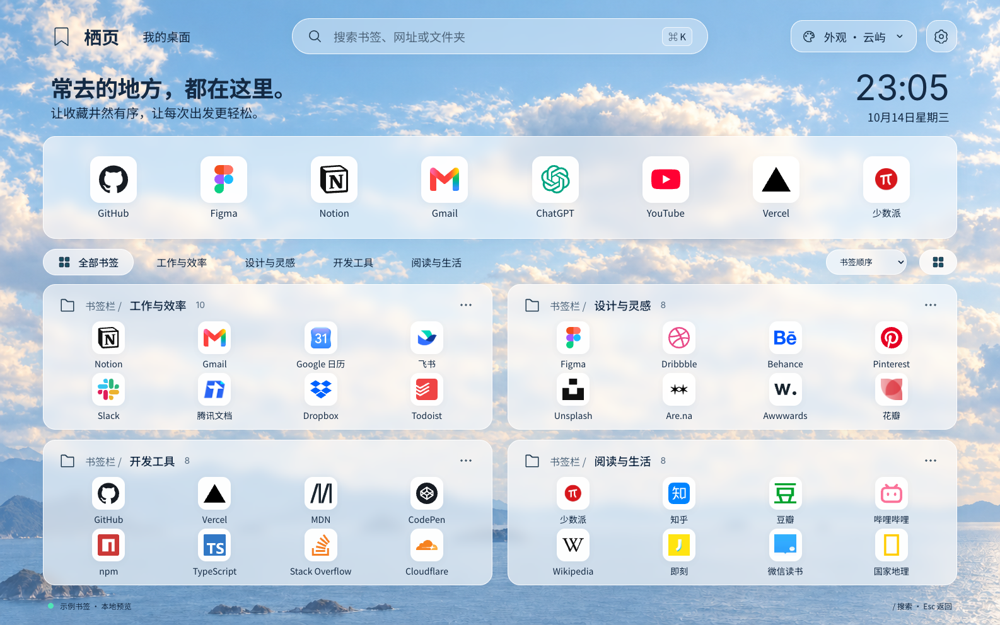

# 栖页 · 云屿书签桌面

把 Chrome 书签栏变成一张本地导航桌面。打开新标签页，直接浏览自己的书签；不用手动导入，不需要账号或服务器。

[下载最新版](https://github.com/xieyuqiyu-source/bookmark-garden/releases/latest) · [公开仓库](https://github.com/xieyuqiyu-source/bookmark-garden) · [Figma A 版设计](https://www.figma.com/design/acfysADpxG5pFDfadqOUSc?node-id=2-16)



## 功能

- **自动读取与更新**：读取当前 Chrome 配置的书签树，新增、删除、改名、移动、重排或导入后自动刷新。
- **A 版云屿界面**：云海壁纸、玻璃面板、大图标入口、横向文件夹导航。文件夹路径与名称保持同一行；长名称省略，悬停可查看完整内容。
- **文件夹浏览**：每张卡片显示直接属于该文件夹的前 8 个书签；紧凑模式显示前 12 个。点击文件夹标题或右键文件夹空白区域展开全部内容。选中父分类时保留后代文件夹，空文件夹也可见。
- **全局搜索**：同时搜索标题、网址、完整文件夹路径。多个空格分隔的词需要全部匹配；不受当前分类限制。结果浮层支持键盘选择，空结果只显示简短提示。
- **书签操作**：鼠标右键打开菜单，打开、在新标签页打开、固定到常用或取消固定。固定只保存书签 ID，不移动原始书签；没有固定项目时常用栏自动收起。
- **设置侧栏**：浅色/深色、玻璃不透明度与模糊、紧凑图标、显示时间/欢迎语/路径/常用栏、默认打开方式。
- **本地壁纸**：上传不超过 3 MB 的 JPG、PNG 或 WebP 图片；壁纸随偏好保存在当前设备，可恢复云海背景。
- **偏好持久化**：自动保存，同一浏览器配置的其他栖页标签页同步变化。升级保留已有固定列表、主题、密度和打开方式；恢复默认保留固定列表。
- **过渡与滚动**：设置侧栏、书签/排序菜单有进入与退出动画，搜索和分类面板淡入；隐藏滚动条但保留滚轮、触控板及键盘滚动，默认跟随系统减少动态效果设置，可在设置中用「过渡动画」开关独立开启或关闭；恢复默认后重新跟随系统。
- **排序与按需展示**：使用玻璃下拉菜单，选中项带勾选标记，支持方向键和回车。原始顺序、名称、最近添加。首页每批 20 个文件夹，文件夹浮层和搜索结果每批 120 条。
- **窄窗口适配**：单列文件夹面板，常用入口及分类横向滚动；设置内容独立滚动。

普通网页预览使用公共示例和本地品牌图标，底部标注“示例书签”。真实扩展始终使用自己的书签与 Chrome favicon，读取失败时不会冒充示例数据。

## 安装

### 下载安装包（推荐）

无需安装 Node.js 或运行开发服务器。

1. 打开 [GitHub Releases 最新版](https://github.com/xieyuqiyu-source/bookmark-garden/releases/latest)，在 **Assets** 中下载 `qiye-版本号.zip`。不要选择 `Source code`，那是需要自行构建的源码。
2. 将 ZIP 解压到固定目录，例如 `应用/栖页`。解压后的文件夹中应有 `manifest.json`、`index.html` 和 `assets`。
3. 在 Chrome 地址栏输入 `chrome://extensions/`，开启右上角「开发者模式」。
4. 点击「加载已解压的扩展程序」，选择包含 `manifest.json` 的文件夹。
5. 打开新标签页；如果 Chrome 询问是否保留更改，选择保留。

支持 Chrome 114+；目前已在 macOS Chrome 验证，Windows/Linux 尚未实机验证。加载后请保留安装文件夹，不要移动或删除。包内附有可离线打开的 `安装指南.html`。

**更新 ZIP 安装版本**：关闭栖页标签页，将新 ZIP 的全部内容覆盖解压到原来的安装目录；在 `chrome://extensions/` 点击栖页的刷新按钮，再打开新标签页。不要先卸载扩展，保持原安装目录可保留扩展身份及本地偏好。

### 从源码安装

需要 Node.js 22.18+、pnpm 10+。已在 Node.js 24.12 下验证。

```bash
git clone https://github.com/xieyuqiyu-source/bookmark-garden.git
cd bookmark-garden
pnpm install
pnpm build
```

然后：

1. 打开 Chrome 的 `chrome://extensions/`。
2. 开启右上角“开发者模式”。
3. 点击“加载已解压的扩展程序”，选择项目内的 **`dist` 文件夹**。
4. 打开新标签页；若 Chrome 询问是否保留更改，选择保留。

工具栏上的栖页图标也能打开桌面。安装后不需要运行开发服务器，不要移动或删除所加载的文件夹。

### 使用本地 ZIP

构建后可自行生成安装包：

```bash
mkdir -p releases
(cd dist && zip -r ../releases/qiye-1.1.3.zip .)
```

先解压 ZIP，再加载包含 `manifest.json` 的文件夹。仓库不提交 `dist/` 或生成的 ZIP，GitHub 的源码 ZIP 需要先构建。

### 启动、更新与卸载

- **启动 Chrome 就进入栖页**：Chrome 设置 → 启动时 → 打开新标签页。选择“继续浏览上次打开的网页”时，Chrome 会恢复原来的标签。
- **更新**：`git pull && pnpm install && pnpm build`；在扩展管理页点击栖页的刷新按钮，再打开新标签页。使用相同的安装目录可保留扩展身份与本地偏好。
- **卸载**：在扩展管理页移除。原始书签保持不变；扩展本地偏好可能被 Chrome 清除。
- **隐藏书签栏**：macOS `⌘ + Shift + B`，Windows/Linux `Ctrl + Shift + B`。

## 快捷键

| 快捷键                 | 操作                                               |
| ---------------------- | -------------------------------------------------- |
| `/`、`⌘ / Ctrl + K`    | 聚焦搜索                                           |
| `↑`、`↓`               | 选择搜索结果或菜单项                               |
| `Enter`                | 打开当前搜索结果或执行菜单项                       |
| `Shift + F10` / 菜单键 | 打开当前书签的操作菜单                             |
| `Home`、`End`          | 跳到书签菜单的首项/末项                            |
| `Esc`                  | 关闭当前浮层；退出搜索时保留输入，清空按钮单独清除 |
| `Tab`                  | 移动焦点；模态浮层内保持焦点，关闭后回到触发控件   |

## 本地数据与权限

没有后端、登录、分析统计或第三方图标请求。壁纸、图标、字体和脚本随安装包提供；书签索引只在页面内存中构建。

| 权限        | 用途                                                                                      |
| ----------- | ----------------------------------------------------------------------------------------- |
| `bookmarks` | 读取书签和监听变化。Chrome 授权提示可能包含修改能力，项目不调用书签创建、删除或移动接口。 |
| `storage`   | 在 `chrome.storage.local` 保存固定 ID、外观、壁纸、布局和打开方式。                       |
| `favicon`   | 使用 Chrome 内置 favicon 接口显示网站图标。                                               |

没有站点 host 权限、浏览历史权限或标签内容读取权限。扩展不主动向服务端发送书签；点击网站后才正常导航到目标网址。Chrome 自身的账号同步与图标缓存由浏览器管理。

普通网页预览使用独立的 `localStorage` 键 `qiye-preview`，不与扩展共享数据。偏好不跨设备同步。保存失败时回退到最近成功保存的状态，并显示错误。

## 开发与验证

```bash
pnpm install
pnpm dev --host 127.0.0.1 --port 5177
```

浏览器访问 `http://127.0.0.1:5177` 查看演示；真实书签 API 需要加载构建后的扩展。

```bash
pnpm test       # 数据逻辑测试
pnpm lint       # oxlint
pnpm build      # TypeScript 校验 + 生产构建
```

浏览器集成测试使用 Python Playwright，在独立临时浏览器配置中创建测试书签，不访问个人浏览器数据：

```bash
python3 -m venv .venv
.venv/bin/pip install -r tests/requirements.txt
.venv/bin/python -m playwright install chromium
# 另一个终端保持 pnpm dev 运行，并先执行 pnpm build
.venv/bin/python tests/browser_test.py --extension
```

可以通过 `--url` 指定预览地址，通过 `--browser` 指定 Chrome for Testing 或 Chromium 可执行文件。测试截图写入被 Git 忽略的 `artifacts/verification/`。

检查内容包括：

- 嵌套/空文件夹、搜索与排序、异常偏好迁移、安全协议、5000 条书签完整性。
- 搜索和键盘、固定持久化、嵌套模态框、设置往返、图片校验、恢复默认、320–1586px 五种窗口宽度。
- 真实生产扩展的新标签覆盖、书签增改移删、跨标签偏好同步、保存失败回退、120 条分页。
- 无未处理页面异常、演示页无远程资源请求；检查生产扩展的壁纸 URL 及图片实际加载。

## 项目结构

```text
src/
  App.tsx                        桌面组合、分类与浮层状态
  index.css                      云屿主题、桌面网格与响应式
  styles/                        搜索/菜单/文件夹浮层、设置样式
  components/Dialog.tsx          原生模态框、焦点恢复、滚动锁定
  features/bookmarks/
    api.ts                       Chrome API 与预览适配
    model.ts                     树处理、分组、搜索排序、偏好校验
    useBookmarks.ts              加载监听、串行保存与失败回退
    DesignIcon.tsx               Figma 图标、favicon 与首字回退
    BookmarkTile.tsx              书签入口与菜单触发
    BookmarkMenu.tsx              打开、固定与取消固定
    FolderPanel.tsx               文件夹卡片与展开浮层
    SearchBox.tsx                 全局搜索与键盘选择
    SettingsPanel.tsx             外观、布局、壁纸和打开方式
    SortControl.tsx              玻璃排序菜单与键盘选择
    DesktopToolbar.tsx           顶部品牌、搜索与设置入口
    demo.ts                      公共示例书签
public/
  assets/main/                   Figma 导出的独立壁纸与图标
  manifest.json                  Manifest V3 配置
  background.js                  工具栏按钮打开桌面
  icons/                         扩展图标
  安装指南.html / guide.css       离线安装说明
docs/                            预览图与素材说明
tests/                          数据与浏览器集成测试
```

## 设计与边界

设计基准、尺寸和状态说明见 [DESIGN.md](DESIGN.md)，素材来源见 [docs/ASSETS.md](docs/ASSETS.md)。

- 当前实现 A 云屿一套主题，支持深浅色；未添加其他风格、AI 分类、拖拽修改原始书签或云同步。
- 网站图标取决于 Chrome 缓存；加载失败回退为标题首字。不会为了图标向第三方发送书签地址。
- `javascript:`、`data:` 等链接可见但禁止打开；`file:` 和浏览器内部页面能否导航还受 Chrome 策略限制。
- 多个新标签扩展可能冲突；隐身新标签页、企业策略可能限制扩展能力。
- 已验证 5000 条书签的数据处理；尚未对数十万条书签进行性能验证。
- 目前通过本地加载安装，尚未发布 Chrome 应用商店。

## 官方资料

- [Chrome 书签 API](https://developer.chrome.com/docs/extensions/reference/api/bookmarks)
- [覆盖新标签页](https://developer.chrome.com/docs/extensions/develop/ui/override-chrome-pages)
- [Chrome favicon 接口](https://developer.chrome.com/docs/extensions/how-to/ui/favicons)
